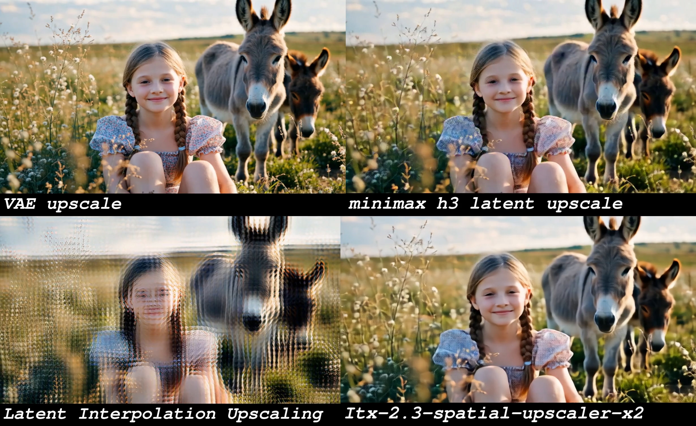
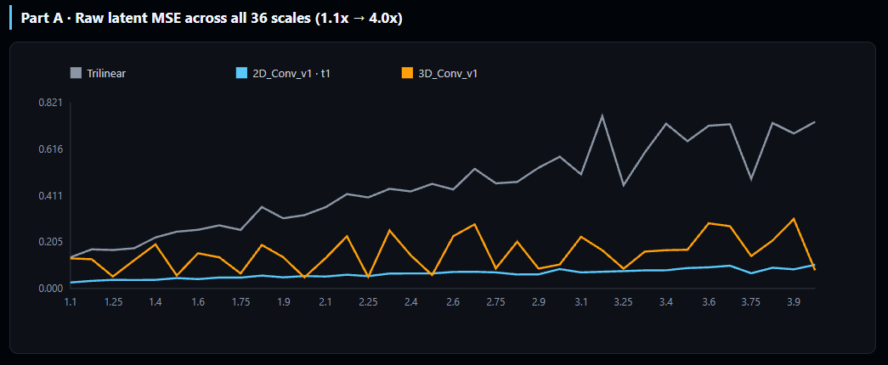

<p align="center">
  <a href="./README.md"><strong>English</strong></a> ·
  <a href="./README_zh.md">中文</a>
</p>

<div align="center">

# ComfyUI Minimax H3 Latent Upscaler

**Neural Latent Upscaler for Minimax H3 Video Generation**
Learned · High-fidelity · 2D & 3D Variants

</div>

## 📰 News

- [2026-11-10] 🚀 **New 2D-conv release — `minimax_h3_latent_upscaler_2d_conv_v1`**: a 2D conv backbone (Conv2d) with interleaved temporal Conv1d — **182M parameters** (3D: 345M, roughly half) and a **~364 MB** fp16 checkpoint (3D: ~691 MB). Across all 36 scales it cuts latent MSE by **84.7%** vs trilinear (3D: 61.1%); below 1.5× it still delivers ~**80%** (3D only 28%); pixel-domain PSNR averages **30.47 dB** (3D: 29.30 dB). It also offers **6 sharpness tiers** (the 3D model has none) and covers the full 1.1×–4.0× range. The 3D model only leads on the scales it was trained on (2×/2.25×/2.5×/4×), and that lead is small: measured on the shared trilinear baseline, 2D lands at **83.0%–86.4%** and 3D at **84.7%–89.1%** — a **1.0–3.3 percentage-point** gap (absolute MSE difference 0.004–0.024). The "3D is 7.5%–30.5% better" figure is a relative difference on top of that already tiny residual, not a difference in overall quality. Temporal consistency is only marginally better too (frame-diff ratio 0.867 vs 0.850). See the [full comparison report](https://huggingface.co/LBH-123-AI/Minimax_h3_latent_Upscaler/blob/main/examples/3D_Conv_v1_vs_2D_Conv_v1.html) and the per-scale chart below.
- [2026-11-10] 🧩 **2D node brought up to parity with 3D**: three resize modes (`scale by multiplier` / `target dimensions` / `megapixels`), `rocm` backend, `force_unload` VRAM offload, pixel-grid `align`; plus a new **Sharpness** tier selector (1–6) and **Temporal Chunking** (`chunked` / `single pass`).

- [2026-08-28] 🚀 **New node combo — MMH3 Split Upscale**: three new nodes (`MMH3 Temporal Split Params`, `MMH3 Spatial Split Params`, `MMH3 Split Upscale`) perform a tiled, hires-fix style latent re-sampling upscale for H3 video. Decomposed and optimized from the **Comfyui-MMH3-UltimateUpscale** project — splitting the AV latent into temporal chunks and spatial tiles, resampling each piece, and stitching with seam denoise, two-level color matching and temporal anchors. Key upgrades vs. original: more stable seams (`seam_denoise` + probe-gated seam polish), zero color drift (two-level matching + first-block/every-chunk pin-source), triple temporal anchors (frame-0/motion/identity), easier use (spatial params simplified to overlap/fade percentages snapping to the latent grid), and a lighter footprint (built-in upscale model removed in favor of an external pre-upscaled latent).
- [2026-08-26] 🚀 **3D node memory & UX optimizations**: zero-copy model loading plus ComfyUI's native `soft_empty_cache` and explicit `.contiguous()` calls reduce RAM/VRAM spikes during load and inference; the post-inference CPU offload is now an optional `force_unload` toggle (default on); `enable_chunking` is renamed to `enable_temporal_chunking` and its effective chunk stride raised from 24 to 32; model files can now live in subfolders (PR #30); `target dimensions` and `megapixels` upper limits raised to 8192 px and 16 MP.
- [2026-08-23] 🚀 **3D node improvements**: added an `enable_chunking` toggle (turn off for short clips to use full-context inference); fixed temporal-chunk edge artifacts with replicate padding and weighted overlap blending, eliminating end-frame flicker; added ROCm (AMD GPU) backend support via the new `rocm` device option.
- [2026-08-21] 🚀 **3D node optimization**: The model is automatically offloaded to CPU after execution to free VRAM for subsequent second-pass sampling; width and height are independently aligned to the align grid (default 32), fixing the bottom light band issue; normalization/denormalization is changed from in-place operations to standard operations; temporal chunking is retained to support long videos.
- [2026-08-19] 🚀 **3D node overhaul**: all three resize modes (`scale by multiplier`, `target dimensions`, `megapixels`) merged into a single node; fixed aspect-ratio mismatch in certain modes and edge artifacts at specific sizes; added a new example workflow and expanded the usage notes.
- [2026-08-18] 🔥 **Precision selector**: both 2D and 3D nodes now support `fp32` / `fp16` / `bf16` inference.
- [2026-08-17] 🎉 **Initial release**: Minimax H3 Latent Upscaler 2D + 3D nodes with bilingual README and inline examples.

A custom ComfyUI node that upscales **Minimax H3** VAE latents (24 channels) with a trained
neural network instead of naive interpolation. Its main purpose is to **accelerate
high-resolution video generation** and improve quality:

- **Skip the slow decode → pixel-upscale → encode round-trip.** Minimax H3 ships a heavy
  ~5B-parameter VAE, so decoding and re-encoding latents is expensive. Upscaling directly in
  latent space avoids that costly round-trip entirely.
- **Enable a faster generation pipeline:** generate at low resolution (far fewer latent tokens),
  upscale the latent with this node, then refine at the target resolution.

It also **avoids the ghosting / double-image artifacts** that naive latent interpolation
(bilinear/bicubic) introduces, and plays a role similar to the latent upscaler in **LTX2.3**.

⚠️ This saves **time, not VRAM** — the refinement pass still runs at the target resolution, so
peak memory is comparable to generating high-res directly. The win is purely speed.

Two node variants are provided, both registered under the `video/MinimaxH3` category. Their
parameters are **almost identical** — the 2D node adds a `sharpness` selector and exposes temporal
chunking as a dropdown, the 3D node as a boolean toggle:

- **Minimax H3 Latent Upscaler (2D)** — a 2D conv backbone with interleaved temporal convolutions.
  Spatial (H×W) upscaling only; the time dimension is preserved. Lightweight and fast. Pairs with
  the `*_2d_conv_v1` checkpoint and supports 6 sharpness tiers.
- **Minimax H3 Latent Upscaler (3D)** — a fully 3D-convolution backbone (3D conv blocks +
  TemporalConv + trilinear interpolation). Processes the spatiotemporal volume jointly for slightly
  better temporal coherence, at ~1.9× the parameters and compute. Pairs with `*_3d_conv_v1`.

> Weights and backbone must match: the 2D node loads 2D checkpoints, the 3D node loads 3D
> checkpoints. Picking the wrong one fails loudly with a structure mismatch instead of silently
> producing garbage.

Both nodes ship **three resize modes**:

- `scale by multiplier` — classic `scale` factor (1.0×–4.0×).
- `target dimensions` — directly set target pixel `width`/`height`.
- `megapixels` — set a target total pixel count in megapixels (e.g. `1.2`); keeps aspect ratio.

The `target dimensions` and `megapixels` modes align the output to a configurable pixel grid and
derive the effective scale automatically, so any target between 1.0×–4.0× works.

> Both nodes support **upscaling only** (`effective scale >= 1.0`). `scale = 1.0` returns the input
> unchanged; an effective scale below `1.0` raises an error.

### Sharpness tiers (2D checkpoints only)

Checkpoints with a tier channel expose a `Sharpness` parameter (1–6):

- **1** = closest to the reference (softest, lowest MSE) — the default and the recommended setting.
- **6** = sharpest (most detail, furthest from the exact target).

Older checkpoints without a tier channel silently ignore it (treated as 1) and print a one-line
notice in the console.

> Sharpness exists only in the `2d_conv_v1` weights: `3d_conv_v1` has no adjustable sharpness, and
> its output sharpness measures equivalent to 2D tier t1.

### MMH3 Split Upscale (combo)

> **Origin:** this combo is a **decomposed and re-optimized version of the
> Comfyui-MMH3-UltimateUpscale project**. The original monolithic node was broken into three composable nodes (temporal split /
> spatial split / main upscaler), and the enhancements below were layered on top of the original tiling
> logic to improve seam stability, color consistency, temporal coherence, usability, and footprint.

A separate three-node combo that does a **tiled, hires-fix style re-sampling upscale** directly
inside the diffusion sampler — instead of a pre-trained upscaler network. It takes the H3 **AV
latent** (nested video 24ch + audio 32ch), splits it into **temporal chunks** and **spatial tiles**,
runs the sampler on each piece, then stitches them back seamlessly with seam-denoise, two-level color
matching and temporal anchors so seams and ghosting don't appear. The two `* Split Params` nodes
configure the splitting and feed the main `MMH3 Split Upscale` node (both optional — leave them
unconnected for a single full-frame pass). It requires a `model` + `conditioning` + `sampler`/`sigmas`,
i.e. it re-runs sampling at the higher resolution.

**Key enhancements vs. the original project:**

- **🧩 More stable seams (Seam / Ghosting):** a seam-neighborhood denoise cap (`seam_denoise`) plus a probe-gated second-pass seam polish (`seam_polish`) remove seams and ghosting; even under high denoise + fast motion, moving objects are no longer sliced ("broken limbs").
- **🎨 Zero color drift (Color Zero-Drift):** spatial + temporal two-level color matching, with a global color reference pinned to the **first block** and to **every chunk** (`grade_pin`) — eliminates inter-tile flicker and the localized cyan/green tint (e.g. top-left corner).
- **⏱️ Stronger temporal continuity:** a **triple temporal anchor** — `frame-0 anchor` + `motion anchor` + `identity anchor` — automatically backs up identity consistency under high denoise, so subjects don't drift.
- **🖱️ Easier to use:** spatial parameters cut from 9 fields down to **percentages** (overlap ratio / fade ratio) that auto-snap to the latent grid; `negative` sits right next to `conditioning` for a more intuitive layout.
- **🪶 Lighter footprint:** the built-in upscale model was removed in favor of an **external pre-upscaled latent** input — more controllable VRAM, and a node that stays focused on its job.

**Modules added / optimized (relative to the original project):**

| Module | What it adds / optimizes |
| :--- | :--- |
| **Prevention (预防)** | Freeze-prefill overlap band + **triple temporal anchors** (frame-0 anchor + motion anchor + identity anchor) + cross-fade stitching — stops seams and forks from forming in the first place. |
| **Correction (校正)** | **Two-level (spatial + temporal) color matching** + first-block source reference + per-chunk global pin-source (`grade_pin`) — keeps color & brightness consistent across tiles and chunks, killing inter-tile flicker and localized cyan/green tint. |
| **Anti-forking (抗分叉)** | `seam_denoise` cap — under high denoise + fast motion, the seam neighborhood is re-sampled at *medium* denoise so moving objects aren't sliced ("broken limbs"); combined with the probe-gated second-pass seam polish, seams and ghosting are both eliminated (suggested 0.5–0.8; 1.0 = off). |
| **Fixes (修复)** | **Per-tile independent Guider** + cropped keyframes, and a **fixed probe-gated seam polish** (`seam_polish`) — each tile gets correctly-scoped conditioning/keyframes, and the polish gating no longer over/under-applies. |
| **Simplification (简化)** | `overlap` / `fade` are now **percentage parameters** (overlap ratio / fade ratio, resolution-independent) instead of absolute pixels, and auto-snap to the latent grid; `negative` sits next to `conditioning` for a more intuitive layout. |

---

## 📸 Examples

**Video upscale comparison**

<video src="examples/Minimax_h3_latent_Upscaler_001.mp4" controls width="640"></video>

**Image upscale comparison**



**2D vs 3D across all 36 scales** — full MSE / PSNR / sharpness / temporal charts:
[`examples/3D_Conv_v1_vs_2D_Conv_v1.html`](https://huggingface.co/LBH-123-AI/Minimax_h3_latent_Upscaler/blob/main/examples/3D_Conv_v1_vs_2D_Conv_v1.html).

---

## 📁 Project Structure

```text
Comfyui_Minimax_h3_latent_Upscaler/
├── examples/
│   ├── Minimax_h3_latent_Upscaler_001.mp4
│   ├── Minimax_h3_latent_Upscaler_002.jpg
│   └── 3D_Conv_v1_vs_2D_Conv_v1.png     # per-scale MSE chart (2D vs 3D)
├── workflow_templates/
│   └── minimax_h3_r2v_Latent Upscaler example workflow.json  # example workflow for ComfyUI templates
├── nodes/
│   ├── __init__.py                       # merges 2D/3D/Split node mappings
│   ├── minimax_h3_latent_upscaler_2d.py  # 2D backbone + temporal convs (3 resize modes + sharpness + chunking)
│   ├── minimax_h3_latent_upscaler_3d.py  # pure 3D convolution with 3 resize modes
│   └── MMH3_Split_Upscale.py             # MMH3 Split Upscale combo (decomposed from Comfyui-MMH3-UltimateUpscale)
├── README.md
├── README_zh.md
└── __init__.py
```

> The model weights are **not** included in this repo. Place them in your ComfyUI models folder
> (see Model Placement below).

---

## 🚀 Key Features

- ✅ **Learned latent upscaling** — neural network trained for Minimax H3 latents, far sharper
  than bilinear/bicubic interpolation.
- ✅ **Two backbones, two checkpoints** — `2d_conv_v1` covers every scale at half the size with
  adjustable sharpness; `3d_conv_v1` is more accurate on 2×/2.25×/2.5×/4× and marginally better on
  temporal consistency (frame-diff ratio 0.867 vs 0.850). Node and checkpoint pair one-to-one.
- ✅ **Three ways to set output size on both nodes** — `scale by multiplier`, `target dimensions`,
  or `megapixels`, all with pixel-grid alignment and aspect-ratio lock.
- ✅ **Sharpness tiers** — one checkpoint spans 1 (most faithful) to 6 (sharpest), so you don't need
  a separate file per look.
- ✅ **Temporal chunking** — `chunked` caps VRAM on long clips, `single pass` runs the whole clip in
  one forward pass; older workflows keep working.
- ✅ **Tiled hires-fix upscaler (MMH3 Split Upscale combo)** — re-sample the H3 AV latent at higher
  resolution by splitting into temporal chunks + spatial tiles, with seam-denoise, two-level color
  matching and temporal anchors to avoid seams and ghosting.
- ✅ **24-channel Minimax H3 latent** — uses the exact per-channel mean/std normalization from
  training.
- ✅ **Auto architecture detection** — reads `in_channels`, block counts, temporal config and
  kernel size straight from the checkpoint; no manual config needed.
- ✅ **Robust weight loader** — supports `.safetensors` and `.pth`; auto-converts FP8→FP16;
  tolerates the `upscaler.` prefix in merged checkpoints.
- ✅ **Strict weight validation** — missing key layers raise an error instead of silently
  random-initializing (which would produce noise).
- ✅ **Flexible precision/device** — `cuda`/`rocm`/`cpu` and fp32/fp16/bf16 options.
- ✅ **Plug-and-play** — standard ComfyUI node, no changes to your existing workflow.

Inference forces attention **off** (`attn=False`) for speed and stability. Loaded models are
cached by `(name, device, precision)` so repeated runs stay cheap.

---

## 📦 Installation

1. Clone this repository into ComfyUI's `custom_nodes` folder:

   ```bash
   cd ComfyUI/custom_nodes
   git clone https://github.com/LBH-123-AI/Comfyui_Minimax_h3_latent_Upscaler.git
   ```

2. Required dependencies (`torch`, `einops`, `safetensors`) are already present in a standard
   ComfyUI environment — no extra install needed.

3. Restart ComfyUI.

---

## 🤖 Model Placement

The nodes scan and load weights from:

```text
ComfyUI/models/latent_upscale_models/
```

Put your Minimax H3 latent upscaler checkpoint (`.safetensors` or `.pth`) there. It will appear
automatically in the node's `model_name` dropdown.

Pre-trained checkpoints are available at:
[huggingface.co/LBH-123-AI/Minimax_h3_latent_Upscaler](https://huggingface.co/LBH-123-AI/Minimax_h3_latent_Upscaler)

Every release ships three precisions — pick one that fits your GPU:

| Release | fp16 / bf16 | fp32 (.pth) | Parameters |
| :--- | :--- | :--- | ---: |
| `minimax_h3_latent_upscaler_2d_conv_v1` (2D backbone) | ~364 MB | ~729 MB | 182M |
| `minimax_h3_latent_upscaler_3d_conv_v1` (3D backbone) | ~691 MB | ~1.38 GB | 345M |

**fp16 is the recommended default**: it is numerically almost identical to fp32. Use `bf16` on GPUs
without fp16 fast paths (same size, slightly lower accuracy); `fp32` is the reference checkpoint for
conversion and bit-exact verification.

The loader auto-detects the architecture (channel count, block counts, temporal config, tier
channel), so **checkpoints are not interchangeable between the two nodes**: `2d_conv_v1` only
loads in the 2D node, `3d_conv_v1` only in the 3D node.

### Which checkpoint: 2D or 3D?

Measured on the same frozen 2,500-pair validation split:

| Metric (average over 36 scales) | Trilinear | 2D_Conv_v1 | 3D_Conv_v1 |
| :--- | ---: | ---: | ---: |
| latent MSE improvement vs trilinear | — | **84.7%** | 61.1% |
| Improvement below 1.5× | — | **~80%** | 28% |
| Pixel-domain PSNR (after VAE decode) | 23.54 dB | **30.47 dB** | 29.30 dB |
| Temporal consistency (latent frame-diff ratio, truth = 1.000) | 0.900 | 0.850 | **0.867** |
| Adjustable sharpness | — | **6 tiers** | none |
| Parameters / fp16 size | — | **182M / 364 MB** | 345M / 691 MB |

**Raw latent MSE across all 36 scales (lower is better)**



> Grey = trilinear, blue = `2D_Conv_v1` (t1), orange = `3D_Conv_v1`. 2D stays pinned to the floor as
> an almost flat line, holding 11%–15% of trilinear's error at every scale; 3D only dips below 2D at
> the scales it was trained on (2×/2.25×/2.5×/4×) and bounces back elsewhere — at 1.1× it nearly
> coincides with trilinear (0.133 vs 0.138), and at 1.3×/2.2× it only improves by 30%–45%. This chart
> is the most direct illustration of "2D wins coverage, 3D wins specific scales".

- **2D wins on coverage**: a large advantage below 1.5×, adjustable sharpness, half the size.
- **3D wins on the scales it was trained on, but the margin is small**: only 2×/2.25×/2.5×/4× flip,
  details in the table below.

**The four scales where 3D leads (common baseline: improvement vs trilinear)**

| Scale | Trilinear MSE | 2D_Conv_v1 MSE (improvement) | 3D_Conv_v1 MSE (improvement) | 3D vs 2D |
| :--- | ---: | ---: | ---: | ---: |
| 2× | 0.32384 | 0.05489 (+83.0%) | **0.04947 (+84.7%)** | 11.0% lower |
| 2.25× | 0.40259 | 0.05475 (+86.4%) | **0.05091 (+87.4%)** | 7.5% lower |
| 2.5× | 0.46205 | 0.06644 (+85.6%) | **0.05906 (+87.2%)** | 12.5% lower |
| 4× | 0.73592 | 0.10464 (+85.8%) | **0.08016 (+89.1%)** | 30.5% lower |

How to read it: against the shared trilinear baseline both models land in the **83%–89%** band, and
3D is only **1.0–3.3 percentage points** ahead (absolute MSE difference 0.004–0.024). The 7.5%–30.5%
column is a relative difference computed on that already-tiny residual, not a 30% quality gap.

**Temporal consistency** (latent frame-diff ratio; 1.000 = same frame-to-frame dynamics as the truth,
<1 = "quieter" than the truth, >1 = "jitterier"):

| Scale | LR as-is | Trilinear | 2D_Conv_v1 | 3D_Conv_v1 | 3D vs 2D |
| :--- | ---: | ---: | ---: | ---: | ---: |
| 1.5× | 1.019 | 0.880 | 0.848 | 0.857 | closer to truth by 0.009 |
| 2× | 1.031 | 0.869 | 0.900 | 0.908 | closer to truth by 0.008 |
| 3× | 1.032 | 0.904 | 0.892 | 0.898 | closer to truth by 0.006 |
| 4× | 1.069 | 0.946 | 0.761 | 0.805 | closer to truth by 0.044 |
| **Average** | 1.038 | 0.900 | 0.850 | **0.867** | **+0.017** |

All three average below 1.000, i.e. every output is a little "quieter" than the truth (some fine
detail or motion gets smoothed away). 3D's 0.867 sits closer to 1.000 than 2D's 0.850, and the gap
peaks at 4× (0.805 vs 0.761); between 1.5× and 3× it stays under 0.01, i.e. not visible. **So the
"better temporal consistency" claim only carries real weight at 4×.** (At 2× trilinear's 0.869 is
closest to 1.000, but that is interpolation ringing amplifying frame noise, not more faithful detail.)

---

## 🧩 Usage

Add the node you need from the `video/MinimaxH3` menu, connect a `LATENT`, pick the model, set the
resize mode / scale, and decode.

**Typical workflow:**
- **Quick preview:** `[Minimax H3 Latent] → [H3 Latent Upscaler] → [VAE Decode]`
- **High quality / time-saving (recommended):** `[Low-res Latent] → [H3 Latent Upscaler] → [Refine / Re-sample] → [VAE Decode]`

Compared to the naive approach `[Latent] → [VAE Decode] → [Pixel Upscaler] → [VAE Encode] → …`,
upscaling directly in latent space skips the expensive VAE decode/encode round-trip. Minimax H3's
~5B-parameter VAE makes decode and re-encode notably slow, so this is where most of the time is
saved. It also avoids the **ghosting / double-image artifacts** that direct latent interpolation
(bilinear/bicubic) causes.

⚠️ **VRAM expectations:** this node only saves time — refinement still runs at the target resolution,
so peak memory is close to generating high-res directly. Use `Temporal Chunking` to cap peaks on long
clips.

### Node Reference — 2D

| Parameter | Type | Default | Range / Options | Description |
| :--- | :--- | :--- | :--- | :--- |
| `latent` | LATENT | — | — | Input Minimax H3 latent (B,C,T,H,W) or (B,C,H,W) |
| `model_name` | dropdown | auto | scanned files | Checkpoint in `latent_upscale_models/` |
| `mode` | dropdown | `scale by multiplier` | `scale by multiplier` / `target dimensions` / `megapixels` | How the output size is chosen |
| `scale` | FLOAT | 2.0 | 1.0 – 4.0 (step 0.05) | Used when `mode` is `scale by multiplier` |
| `width` | INT | 1280 | 64 – 8192 (step 8) | Target pixel width (used by `target dimensions`) |
| `height` | INT | 704 | 64 – 8192 (step 8) | Target pixel height (used by `target dimensions`) |
| `megapixels` | FLOAT | 1.0 | 0.1 – 16.0 (step 0.1) | Target total megapixels (used by `megapixels`); keeps aspect ratio |
| `sharpness` | INT | 1 | 1 – 6 | **Sharpness.** 1 = closest to the reference (softest, lowest MSE); 6 = sharpest (most detail, furthest from the exact target). Only checkpoints with a tier channel respond; older ones fall back to 1 |
| `align` | INT | 32 | 1 – 512 | Pixel-grid alignment: output W/H are independently rounded to multiples of this value (strictly recommended: 32) |
| `temporal_chunking` | dropdown | `chunked` | `chunked` / `single pass` | **Temporal Chunking.** Chunked inference caps VRAM on long clips; `single pass` runs one forward pass for the whole clip (most VRAM) |
| `chunk_frames` | INT | 32 | 4 – 256 (step 4) | **Frames per chunk.** Only shown under `chunked`. Each chunk actually forwards this value + 48 frames of temporal context, so don't go too small if you have headroom |
| `force_unload` | BOOLEAN | True | True / False | Unload model to CPU after inference to free VRAM for subsequent nodes; disable if you reuse this node repeatedly |
| `device` | dropdown | cuda | cuda / rocm / cpu | Inference backend (ROCm needs a HIP-enabled PyTorch build) |
| `precision` | dropdown | fp16 | fp32 / fp16 / bf16 | Inference precision |

**Output:** `LATENT` — the upscaled latent, ready for VAE decode.

### Node Reference — 3D

| Parameter | Type | Default | Range / Options | Description |
| :--- | :--- | :--- | :--- | :--- |
| `latent` | LATENT | — | — | Input Minimax H3 latent (B,C,T,H,W) or (B,C,H,W) |
| `model_name` | dropdown | auto | scanned files | Checkpoint in `latent_upscale_models/` |
| `mode` | dropdown | `scale by multiplier` | `scale by multiplier` / `target dimensions` / `megapixels` | How the output size is chosen |
| `scale` | FLOAT | 2.0 | 1.0 – 4.0 (step 0.05) | Used when `mode` is `scale by multiplier` |
| `width` | INT | 1280 | 64 – 8192 (step 8) | Target pixel width (used by `target dimensions`) |
| `height` | INT | 704 | 64 – 8192 (step 8) | Target pixel height (used by `target dimensions`) |
| `megapixels` | FLOAT | 1.0 | 0.1 – 16.0 (step 0.1) | Target total megapixels (used by `megapixels`); keeps aspect ratio |
| `align` | INT | 32 | 1 – 512 | Pixel-grid alignment: output W/H are independently rounded to multiples of this value (e.g. 16/32/64) |
| `enable_temporal_chunking` | BOOLEAN | True | True / False | Split long videos into temporal chunks to cap VRAM; disable for short clips for full-context inference |
| `force_unload` | BOOLEAN | True | True / False | Unload model to CPU after inference to free VRAM for subsequent nodes; disable if you reuse this node repeatedly to avoid reload overhead |
| `device` | dropdown | cuda | cuda / rocm / cpu | Inference backend (ROCm needs a HIP-enabled PyTorch build) |
| `precision` | dropdown | fp16 | fp32 / fp16 / bf16 | Inference precision |

**Output:** `LATENT` — the upscaled latent.

> **Which node to pick?** Default to **2D**: full 1.1×–4.0× coverage, a big advantage at low scales,
> half the file size, adjustable sharpness. Only switch to **3D** when you consistently run
> 2×/2.25×/2.5×/4× and want the extra accuracy — its latent MSE is 7.5%–30.5% lower there (absolute
> difference 0.004–0.024; on the trilinear baseline, 2D ≈ 85% vs 3D ≈ 87%, a 1–3 point gap), and its
> temporal consistency is only marginally better.

### Node Reference — MMH3 Split Upscale (combo)

A tiled, **hires-fix style** re-sampling upscaler for H3 video, **decomposed and optimized from the
Comfyui-MMH3-UltimateUpscale project**. Unlike the 2D/3D nodes (which use a
pre-trained upscaler network), this combo re-runs the diffusion sampler on a higher-resolution
version of the latent, split into pieces so it fits in VRAM. It operates on the H3 **AV latent**
(nested video 24ch + audio 32ch) and requires `model` + `conditioning` + `sampler`/`sigmas`.

**`MMH3 Temporal Split Params`** — how to cut the clip along time (H3's native 5+17·m frame/token grid):

| Parameter | Type | Default | Range / Options | Description |
| :--- | :--- | :--- | :--- | :--- |
| `chunk_frames` | INT | 73 | 5 – 100000 | Chunk length in frames (snapped to H3 token grid) |
| `temporal_overlap_frames` | INT | 22 | 0 – 100000 | Overlap between consecutive chunks |
| `anchor_strength` | FLOAT | 0.999 | 0.0 – 1.0 | Temporal anchor strength |
| `motion_anchor_frames` | dropdown | 22 | 0 / 5 / 22 / 39 | Motion anchor length in frames |
| `identity_anchor_frames` | INT | 24 | 0 – 240 | Spacing of identity anchors |

Output: `temporal_split_param` (custom type, feeds the main node).

**`MMH3 Spatial Split Params`** — how to cut each frame into tiles:

| Parameter | Type | Default | Range / Options | Description |
| :--- | :--- | :--- | :--- | :--- |
| `tile_width` | INT | 512 | 64 – 16384 (step 32) | Tile width in pixels |
| `tile_height` | INT | 512 | 64 – 16384 (step 32) | Tile height in pixels |
| `overlap_ratio` | FLOAT | 0.25 | 0.0 – 0.90 | Overlap as a fraction of the tile |
| `fade_ratio` | FLOAT | 0.50 | 0.0 – 1.0 | Fade band width within the overlap |
| `min_tile_size` | INT | 256 | 0 – 16384 (step 32) | Minimum tile edge; avoids tiny edge tiles |
| `seam_denoise` | FLOAT | 1.0 | 0.1 – 1.0 | Seam-neighborhood denoise cap; <1 prevents fast objects being cut at seams (suggest 0.5–0.8) |

Outputs: `spatial_split_param` (custom type) + `grid_preview` (string, shows the computed tile/overlap grid).

**`MMH3 Split Upscale`** — the main orchestrator:

| Parameter | Type | Default | Range / Options | Description |
| :--- | :--- | :--- | :--- | :--- |
| `model` | MODEL | — | — | Diffusion model used for re-sampling |
| `conditioning` | CONDITIONING | — | — | Positive conditioning |
| `negative` | CONDITIONING | — | optional | Negative conditioning |
| `latent` | LATENT | — | — | Input H3 AV latent (nested video 24ch + audio 32ch); batch 1 only |
| `noise` | NOISE | — | — | Noise source for the sampler |
| `sampler` | SAMPLER | — | — | Sampler |
| `sigmas` | SIGMAS | — | — | Sigma schedule |
| `cfg` | FLOAT | 1.0 | 0.0 – 100.0 | Classifier-free guidance scale |
| `temporal_split_param` | custom | — | optional | From `MMH3 Temporal Split Params` |
| `spatial_split_param` | custom | — | optional | From `MMH3 Spatial Split Params` |
| `seam_polish` | dropdown | off | off / auto / all | Extra de-seam pass on detected seams |
| `color_match` | BOOLEAN | True | True / False | Two-level color matching across tiles/chunks |

**Output:** `LATENT` — the upscaled H3 AV latent, ready for VAE decode.

> **Notes:** Both `* Split Params` nodes are optional — leave them unconnected for a single
> full-frame pass (no temporal/spatial splitting). The combo re-runs the sampler at the higher
> resolution, so it trades extra compute for VRAM headroom on long / high-res clips.

---

## 🧪 Model / Architecture

- **Latent format:** 24-channel Minimax H3 VAE latent, normalized per-channel with the training
  mean/std before inference and de-normalized after.
- **Backbone:** the 2D variant stacks Conv2d blocks (with a 7×7 depthwise large-kernel block every
  3 layers) and interleaves a temporal Conv1d every 2 layers; the 3D variant is pure 3D conv blocks +
  temporal convolutions. **Residuals exist only inside blocks** — each block returns `x + f(x)` via a
  1×1 skip or identity — while the backbone as a whole has **no global residual**: the output is
  produced entirely by the convolutional path with no interpolated/input base added on top.
- **Architecture is inferred from the checkpoint**: `in_channels`, block counts, `channels`, temporal
  config, kernel size, CoordConv/SE/large-kernel flags, learned-upsample branch and tier channel are
  all read from the `state_dict` shapes and key names — no manual config. Both releases use 12+12
  blocks, `temporal_every=2`, `temporal_kernel=5`, `attn=False`; 2D uses `channels=640` (182M
  parameters) and 3D uses `channels=512` (345M).
- **Upsampling:** if the checkpoint carries learned PixelShuffle kernels (`learned_upsample_ks`) they
  are used; otherwise it falls back to feature interpolation — bilinear for the 2D node, trilinear
  for the 3D node. The console prints which path was taken.
- **Temporal handling:** both variants preserve the time dimension (only H×W are scaled); chunked
  inference caps VRAM on long clips.
- **Sharpness tiers:** checkpoints with a tier channel encode `sharpness` into a 32-dim condition fed
  alongside the scale condition; the tier channel is zero-initialized, so checkpoints without it
  behave bit-identically to the previous version.

---

## 📊 Training Data

Training data totals **~160,000 independent pairs** (one low-res latent paired with one high-res
target, excluding sharpness copies): **146,945 pairs** drive the main (scale) training, and
**13,967 groups** of separate footage train the sharpness tiers — each group paired with 1–6 tier
targets, **83,802 pairs** in total.

**By upscale factor (share of the main training set, measured):**

| Scale band | Pairs | Share |
| :--- | ---: | ---: |
| < 1.5× | 13,649 | 9.3% |
| 1.5× – 2.5× | 70,773 | 48.2% |
| 2.5× – 3.5× | 45,023 | 30.6% |
| 3.5× – 4.0× | 17,500 | 11.9% |
| **Total** | **146,945** | 100% |

The five dominant factors are **2.0× (32,624 pairs, 22.2%), 2.5× (15,000, 10.2%), 4.0× (10,500,
7.2%), 1.5× (11,150, 7.6%) and 3.0× (10,824, 7.4%)**; the remaining 0.25-step scales mostly hold
2–3k pairs each (~2.25%). Beyond the fixed buckets, the set includes arbitrary decimal scales between
1.0× and 4.0× so the model generalizes to any continuous `scale` value instead of only the fixed
buckets.

---

## 🙏 Acknowledgments

This node follows the neural-latent-upscaling approach pioneered by
[ComfyUi_NNLatentUpscale](https://github.com/Ttl/ComfyUi_NNLatentUpscale) by **Ttl**
(https://github.com/Ttl). The model architecture also draws on and references the
**LTX 2.3 Spatial Upscaler** (`ltx-2.3-spatial-upscaler-x2-1.1.safetensors`).
Thanks to both projects for the open-source foundation this work builds upon.
