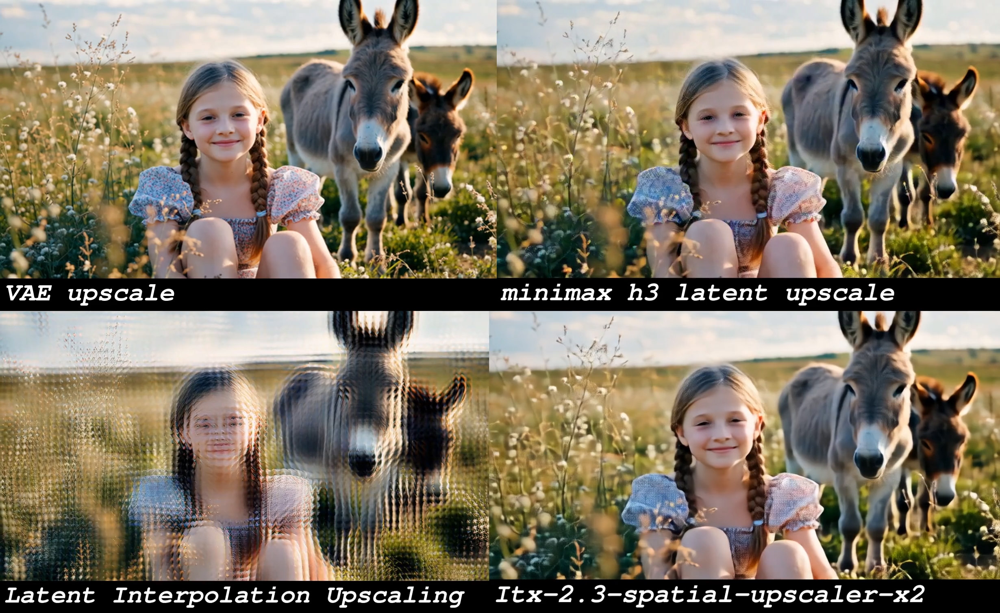
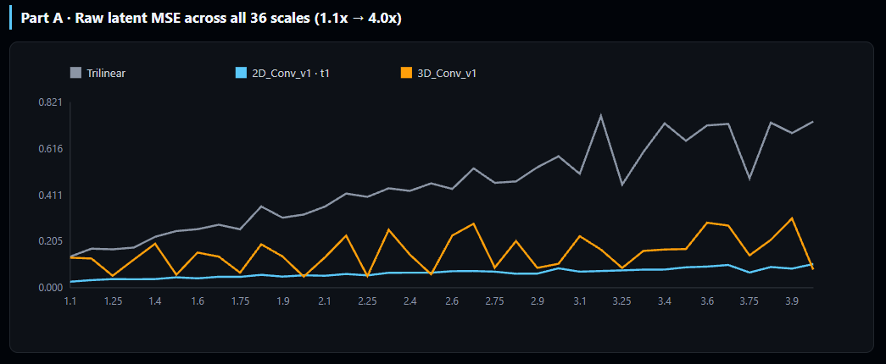

<p align="center">
  <a href="./README.md">English</a> ·
  <a href="./README_zh.md"><strong>中文</strong></a>
</p>

<div align="center">

# ComfyUI Minimax H3 Latent Upscaler

**Minimax H3 视频生成专用 Latent 神经网络放大节点**
学习型 · 高保真 · 2D 与 3D 双版本

</div>

## 📰 更新动态

- [2026-11-10] 🚀 **发布 2D 卷积版本 `minimax_h3_latent_upscaler_2d_conv_v1`**：新权重为 2D 卷积主干（Conv2d）+ 穿插时序卷积（Conv1d），参数量 **1.82 亿**（3D 版 3.45 亿，约为一半），fp16 权重约 **364 MB**（3D 版约 691 MB）。在全部 36 个倍率上，latent MSE 相对三线性降低 **84.7%**（3D 版 61.1%）；1.1×–1.4× 低倍率仍有约 **80%** 的改善（3D 版此时只有 28%）；像素域平均 PSNR **30.47 dB**（3D 版 29.30 dB）。同时支持 **6 档锐度**（3D 版无可调锐度），并覆盖 1.1×–4.0× 全倍率。3D 版只在它训练过的 2×/2.25×/2.5×/4× 上略有优势，且幅度有限：按统一口径「相对三线性的改善」，这四个倍率 2D 是 **83.0%–86.4%**、3D 是 **84.7%–89.1%**，只差 **1.0–3.3 个百分点**（绝对 MSE 差 0.004–0.024）——「3D 比 2D 低 7.5%–30.5%」是在这层很小残差上算的相对差，不是量级差距。时序一致性也略强（帧间差比值 0.867 vs 0.850，偏离真值 13.3% vs 15.0%），差距同样很小。明细见下方「选哪份权重」对比表。完整对比见[对比报告](https://huggingface.co/LBH-123-AI/Minimax_h3_latent_Upscaler/blob/main/examples/3D_Conv_v1_vs_2D_Conv_v1.html)。
- [2026-11-10] 🧩 **2D 节点能力补齐，与 3D 参数对齐**：2D 节点现支持三种缩放模式（`scale by multiplier` / `target dimensions` / `megapixels`）、`rocm` 后端、`force_unload` 显存卸载、像素网格 `align` 对齐，新增 **Sharpness 锐度档位**（1–6）与 **Temporal Chunking 时间分块**（`chunked` / `single pass`）。
- [2026-08-28] 🚀 **新增组合节点 — MMH3 Split Upscale**：新增三个节点（`MMH3 Temporal Split Params`、`MMH3 Spatial Split Params`、`MMH3 Split Upscale`），对 H3 视频做**分块式「高清重采样」放大**。该组合是在 **Comfyui-MMH3-UltimateUpscale** 项目基础上拆解优化而来——把 AV latent 沿时间切块、沿空间分块，逐块重采样后再无缝拼接；相比原版主要增强：更稳的拼接（`seam_denoise` + probe 门控二道缝修补）、颜色零漂移（空间+时间两级颜色匹配 + 首块/每 chunk 钉源）、三重时间锚（frame-0 / motion / identity）、更易用（空间参数简化为重叠率/渐变率百分比并自动吸附网格）、更轻量（移除内置放大模型，改接外部预放大 latent）。
- [2026-08-26] 🚀 **3D 节点显存与使用优化**：采用零拷贝模型加载，并接入 ComfyUI 原生 `soft_empty_cache` 与显式 `.contiguous()`，降低加载与推理期间的显存/内存峰值；推理后卸载到 CPU 改为可选开关 `force_unload`（默认开启）；`enable_chunking` 更名为 `enable_temporal_chunking`，分块有效帧数由 24 提升至 32；模型文件现可放入子目录（PR #30）；`target dimensions` 与 `megapixels` 上限分别放宽到 8192 像素与 16 MP。
- [2026-08-23] 🚀 **3D 节点改进**：新增 `enable_chunking` 开关（短片段可关闭，使用全上下文推理）；修复时间分块边缘伪影——采用 Replicate Padding 与重叠区域加权融合，消除末尾帧闪烁；新增 ROCm（AMD 显卡）后端支持，设备选项新增 `rocm`。
- [2026-08-21] 🚀 **3D 节点优化**：节点执行后自动将模型卸载到 CPU，为后续二次采样释放显存；宽高分别独立对齐到 `align` 网格（默认 32），修复底部光带问题；归一化/反归一化由原地操作改为标准运算，保留时间分块以支持长视频。
- [2026-08-19] 🚀 **3D 节点重构**：三种缩放模式（`scale by multiplier`、`target dimensions`、`megapixels`）合并进单一节点；修复特定模式下造成的比例不统一，修复各类特定尺寸造成的边缘伪影；新增示例工作流供参考。
- [2026-08-18] 🔥 **精度选择**：2D / 3D 节点均支持 `fp32` / `fp16` / `bf16` 推理。
- [2026-08-17] 🎉 **初始发布**：Minimax H3 Latent Upscaler 2D + 3D 双节点、双语 README、内联示例。

一个 ComfyUI 自定义节点，用训练好的神经网络（而非简单插值）对 **Minimax H3** 的 VAE latent
（24 通道）进行放大。它的**主要目的是加速高分辨率视频的生成**，并提升画质：

- **跳过「解码 → 像素放大 → 再编码」的慢速往返。** Minimax H3 自带约 5B 参数的笨重 VAE，
  对 latent 做解码和再编码都很耗时；直接在 latent 空间放大，就彻底省掉了这一往返开销。
- **支持更快的生成流程：** 先低分辨率生成（latent token 少得多），用本节点放大 latent，再在
  目标分辨率下二次采样 / 重绘精修。

同时，它**避免了直接对 latent 插值（双线性/双三次）带来的鬼影、重影问题**，作用类似于
**LTX2.3** 中的 latent 放大模型。

⚠️ 它节省的是**时间，不是显存** —— 精修阶段仍在目标分辨率下运行，峰值显存与直接高清生成接近，
收益纯粹是更快出片。

提供两个节点变体，均注册在 `video/MinimaxH3` 分类下，**参数几乎一致**（2D 多一个 `sharpness`，时间分块在 2D 是下拉、在 3D 是开关）：

- **Minimax H3 Latent Upscaler (2D)**：2D 卷积主干 + 穿插的时序卷积，仅做空间（H×W）放大，
  时间维度保持不变，轻量且快速；对应权重 `*_2d_conv_v1`，支持 6 档锐度。
- **Minimax H3 Latent Upscaler (3D)**：纯 3D 卷积主干（3D 卷积块 + 时序卷积 + 三线性插值），
  联合处理时空体，时间一致性略强，但参数与算力约为 2D 版的 1.9 倍；对应权重 `*_3d_conv_v1`。

> 权重与节点主干必须匹配：2D 节点加载 2D 权重，3D 节点加载 3D 权重。选错时加载器会直接报
> 结构不匹配，而不是静默出错误结果。

两个节点都内置**三种缩放模式**：

- `scale by multiplier`：经典 `scale` 倍数（1.0×–4.0×）。
- `target dimensions`：直接填目标像素 `width` / `height`。
- `megapixels`：填目标总像素（百万像素，例如 `1.2`），保持原宽高比。

`target dimensions` 与 `megapixels` 两种模式会按可配置的像素网格对齐输出，并自动反推等效倍率，
因此 1.0×–4.0× 之间任意目标都能用。

> 两个节点均**只支持放大**（等效 `scale >= 1.0`）。`scale = 1.0` 返回输入原样；等效倍率小于 1.0 会报错。

### Sharpness 锐度档位（仅 2D 权重）

带档位通道的权重暴露一个 `Sharpness` 参数（1–6）：

- **1** = 最贴近原图（最柔和，MSE 最低）——默认值，也是绝大多数场景的推荐值。
- **6** = 最锐（细节最多，但相对精确目标偏离最远）。

旧权重不含档位通道时该参数被静默忽略（按 1 处理），控制台会打印一行提示。

> 锐度档位目前只存在于 `2d_conv_v1` 权重：`3d_conv_v1` 实测没有可调锐度，其输出锐度等价于 2D 的 t1 档。

### MMH3 Split Upscale（组合节点）

> **来源：** 该组合是在 **Comfyui-MMH3-UltimateUpscale** 项目基础上**拆解优化**而来。原本的单节点被拆成三个可组合节点（时间切分 / 空间切分 / 主放大），
> 并在原有分块逻辑之上，针对拼接稳定性、色彩一致性、时间连续性、易用性与轻量化做了系统性增强。

一套独立的**三节点组合**，在扩散采样器内部做**分块式「高清重采样」放大**（而非用预训练放大网络）。
它接收 H3 的 **AV latent**（嵌套：视频 24 通道 + 音频 32 通道），沿**时间切块**、沿**空间分块**，
对每一块单独跑采样器，再用缝降噪、两级颜色匹配与时间锚点把结果**无缝拼接**回去，避免出现接缝和鬼影。
两个 `* Split Params` 节点负责配置切分方式，并喂给主节点 `MMH3 Split Upscale`（两者均可选——
不连接即为整段/整帧单次处理）。它需要 `model` + `conditioning` + `sampler`/`sigmas`，即会在更高
分辨率上重新跑一遍采样。

**相比原版主要增强（拆解优化点）：**

- **🔧 更稳的拼接（Seam / Ghosting）**：缝邻域降噪上限（`seam_denoise`）+ probe 门控的**二道缝修补**（`seam_polish`），消除接缝与鬼影；在高降噪 + 快速运动下，运动物体也不再被切断（"断肢"）。
- **🎨 颜色零漂移（Color Zero-Drift）**：**空间 + 时间两级颜色匹配**，并对**首块**与**每个 chunk** 做全局色基准钉源（`grade_pin`），彻底解决块间闪烁、左上角发青等问题。
- **⏱️ 更强的时间连续性（Temporal Continuity）**：`frame-0 锚` + `motion 锚` + `identity 锚` **三重时间锚**，高降噪时自动兜底身份一致性，人物不漂移。
- **🧩 更易用（Usability）**：空间参数由原本的 9 项精简为**百分比**（重叠率 / 渐变率），并自动吸附 latent 网格；`negative` 紧跟 `conditioning` 布局，连线更直观。
- **🪶 更轻量（Lightweight）**：移除内置放大模型，改接**外部预放大 latent**，显存更可控、节点更专注。

**新增 / 优化的模块（相对于原项目）：**

| 模块 | 新增 / 优化的内容 |
| :--- | :--- |
| **预防（Prevention）** | 冻结预填重叠带 + **三重时间锚**（frame-0 锚 + motion 锚 + identity 锚）+ cross-fade 拼接——让接缝与分叉在生成之初就不出现。 |
| **校正（Correction）** | **空间/时间两级颜色匹配** + 首块源参考 + 每块（chunk）全局钉源（`grade_pin`）——保证各瓦片、各时间块之间的色彩与亮度一致，杜绝块间闪烁与局部发青。 |
| **抗分叉（Anti-forking）** | `seam_denoise` 上限——在高降噪 + 快速运动下，缝邻域以*中等*降噪续写邻居内容，防止运动物体被切断（"断肢"）；配合 probe 门控的二道缝修补，接缝与鬼影一并消除（建议 0.5–0.8；1.0 = 关闭）。 |
| **修复（Fixes）** | **每瓦片独立 Guider** + 裁剪 keyframes，以及**修复版 probe 门控去缝**（`seam_polish`）——每个瓦片获得正确作用域的条件/关键帧，去缝门控不再过度或不足。 |
| **简化（Simplification）** | `overlap` / `fade` 改为**百分比参数**（重叠率 / 渐变率，与分辨率无关），替代原来的绝对像素值，并自动吸附 latent 网格；`negative` 紧跟 `conditioning`，布局更直观。 |

---

## 📸 示例

**视频放大对比**

<video src="examples/Minimax_h3_latent_Upscaler_001.mp4" controls width="640"></video>

**图像放大对比**



**2D 与 3D 逐倍率对比**：完整的 36 档 MSE / PSNR / 锐度 / 时序图表见
[`examples/3D_Conv_v1_vs_2D_Conv_v1.html`](https://huggingface.co/LBH-123-AI/Minimax_h3_latent_Upscaler/blob/main/examples/3D_Conv_v1_vs_2D_Conv_v1.html)。

---

## 📁 项目结构

```text
Comfyui_Minimax_h3_latent_Upscaler/
├── examples/
│   ├── Minimax_h3_latent_Upscaler_001.mp4
│   ├── Minimax_h3_latent_Upscaler_002.jpg
│   └── 3D_Conv_v1_vs_2D_Conv_v1.png     # 2D vs 3D 全倍率 MSE 曲线
├── workflow_templates/
│   └── minimax_h3_r2v_Latent Upscaler example workflow.json  # ComfyUI 模板示例工作流
├── nodes/
│   ├── __init__.py                       # 合并 2D/3D/组合节点映射
│   ├── minimax_h3_latent_upscaler_2d.py  # 2D 主干 + 时序卷积（三模式 + 锐度档位 + 时间分块）
│   ├── minimax_h3_latent_upscaler_3d.py  # 纯 3D 卷积，支持 3 种缩放模式
│   └── MMH3_Split_Upscale.py             # MMH3 Split Upscale 组合（基于 Comfyui-MMH3-UltimateUpscale 拆解优化）
├── README.md
├── README_zh.md
└── __init__.py
```

> 模型权重**不**随仓库提供，请按下方「模型放置」说明放入 ComfyUI 模型目录。

---

## 🚀 核心特性

- ✅ **学习型 latent 放大** — 针对 Minimax H3 latent 训练的神经网络，比双线性/双三次插值清晰得多。
- ✅ **两种主干、两种权重** — `2d_conv_v1` 覆盖全倍率、体积减半、锐度可调；`3d_conv_v1` 在 2×/2.25×/2.5×/4× 上更准，时序一致性只微弱领先（帧间差比值 0.867 vs 0.850）。按场景选，节点与权重一一对应。
- ✅ **两个节点都支持三种输出尺寸方式** — `scale by multiplier` / `target dimensions` /
  `megapixels`，均带像素网格对齐与宽高比锁定。
- ✅ **Sharpness 锐度档位** — 一个权重覆盖 1（最保真）到 6（最锐）六档，按需选择，不必为不同锐度各存一份权重。
- ✅ **长视频时间分块** — `chunked` 分块推理压低显存峰值，`single pass` 整段一次前向；旧工作流自动兼容。
- ✅ **分块式高清重采样（MMH3 Split Upscale 组合）** — 把 H3 的 AV latent 沿时间切块 + 空间分块，
  在更高分辨率上重采样，配合缝降噪、两级颜色匹配与时间锚点，避免接缝与鬼影。
- ✅ **24 通道 Minimax H3 latent** — 使用训练时一致的逐通道均值/标准差做归一化。
- ✅ **自动识别模型结构** — 直接从权重读取通道数、块数、时序配置、卷积核大小与是否带上采样/档位通道，无需手动配置。
- ✅ **严格的权重校验** — 关键层缺失时直接报错退出，而不是静默随机初始化（输出会变成噪声）。
- ✅ **鲁棒的权重加载器** — 支持 `.safetensors` 与 `.pth`；自动 FP8→FP16；兼容合并权重中的 `upscaler.` 前缀。
- ✅ **可选精度与设备** — `cuda` / `rocm` / `cpu` 与 `fp32` / `fp16` / `bf16` 选项。
- ✅ **即插即用** — 标准 ComfyUI 节点，不改变现有工作流。

推理时强制关闭注意力（`attn=False`）以提升速度与稳定性；已加载模型按 `(名称, 设备, 精度)`
缓存，重复调用开销很低。

---

## 📦 安装

1. 将仓库克隆到 ComfyUI 的 `custom_nodes` 文件夹：

   ```bash
   cd ComfyUI/custom_nodes
   git clone https://github.com/LBH-123-AI/Comfyui_Minimax_h3_latent_Upscaler.git
   ```

2. 所需依赖（`torch`、`einops`、`safetensors`）在标准 ComfyUI 环境中已自带，无需额外安装。

3. 重启 ComfyUI。

---

## 🤖 模型放置

节点从这里扫描并加载权重：

```text
ComfyUI/models/latent_upscale_models/
```

把你的 Minimax H3 latent 放大模型权重（`.safetensors` 或 `.pth`）放进该目录，节点下拉框会自动列出。
支持放在子目录里，下拉框会带上子目录名。

预训练权重可在此下载：
[huggingface.co/LBH-123-AI/Minimax_h3_latent_Upscaler](https://huggingface.co/LBH-123-AI/Minimax_h3_latent_Upscaler)

每个版本都提供 fp32 / fp16 / bf16 三档精度，按显卡与工作流选一档即可：

| 版本 | fp16 / bf16 | fp32 (.pth) | 参数量 |
| :--- | :--- | :--- | ---: |
| `minimax_h3_latent_upscaler_2d_conv_v1`（2D 主干） | 约 364 MB | 约 729 MB | 1.82 亿 |
| `minimax_h3_latent_upscaler_3d_conv_v1`（3D 主干） | 约 691 MB | 约 1.38 GB | 3.45 亿 |

**推荐默认 fp16**：与 fp32 数值上几乎无差；`bf16` 给没有 fp16 快速路径的显卡（同体积、精度略低）；
`fp32` 是参考权重，用于转换与逐位校验。

加载器会自动识别结构（通道数、块数、时序配置、是否带锐度档位通道等）。两个版本结构不同、不能互换：`2d_conv_v1` 只接 2D 节点，`3d_conv_v1` 只接 3D 节点。

### 选哪份权重：2D 还是 3D？

同一套验证集（2,500 对冻结验证）上，两个版本的实测差异：

| 指标（36 个倍率平均） | 三线性 | 2D_Conv_v1 | 3D_Conv_v1 |
| :--- | ---: | ---: | ---: |
| latent MSE 相对三线性的改善 | — | **84.7%** | 61.1% |
| 1.1×–1.4× 低倍率改善 | — | **约 80%** | 28% |
| 像素域 PSNR（VAE 解码后） | 23.54 dB | **30.47 dB** | 29.30 dB |
| 时序一致性（latent 帧间差比值，真值 = 1.000） | 0.900 | 0.850 | **0.867** |
| 可调锐度档位 | — | **1–6 档** | 无 |
| 参数量 / fp16 体积 | — | **1.82 亿 / 364 MB** | 3.45 亿 / 691 MB |

**全 36 个倍率的 raw latent MSE（越低越好）**



> 灰 = 三线性，蓝 = `2D_Conv_v1`（t1），橙 = `3D_Conv_v1`。2D 全程贴底、几乎是一条平线，36 个倍率都稳定在三线性的 11%–15%；3D 只在训练过的 2×/2.25×/2.5×/4× 处短暂低于 2D，其余倍率明显反弹——1.1× 处几乎与三线性重合（0.133 vs 0.138），1.3×、2.2× 的改善也只有 30%–45%。这张图就是“2D 赢覆盖面、3D 赢特定倍率”最直观的说明。

- **2D 赢在覆盖面**：低倍率（< 1.5×）优势极大，且多档锐度可调，体积只有一半。
- **3D 赢在训练过的倍率，但幅度有限**：只有 2× / 2.25× / 2.5× / 4× 四个倍率反超，明细见下表。

**3D 占优的四个倍率（统一口径：相对三线性的改善）**

| 倍率 | 三线性 MSE | 2D_Conv_v1 MSE（相对三线性改善） | 3D_Conv_v1 MSE（相对三线性改善） | 3D 比 2D 再低 |
| :--- | ---: | ---: | ---: | ---: |
| 2× | 0.32384 | 0.05489（+83.0%） | **0.04947（+84.7%）** | 11.0% |
| 2.25× | 0.40259 | 0.05475（+86.4%） | **0.05091（+87.4%）** | 7.5% |
| 2.5× | 0.46205 | 0.06644（+85.6%） | **0.05906（+87.2%）** | 12.5% |
| 4× | 0.73592 | 0.10464（+85.8%） | **0.08016（+89.1%）** | 30.5% |

读法：换成「相对三线性改善」这个统一口径后，两者都是 **83%–89%** 的量级，3D 只多 **1.0–3.3 个百分点**
（绝对差 0.004–0.024）。表里最后一列的 7.5%–30.5% 是在这层残差上算的相对差，不是“画质差三成”。

- **时序一致性：3D 只领先一点点** —— 见下表，平均帧间差比值 0.867 vs 0.850，偏离真值
  **13.3% vs 15.0%**（相对改善约 11%，绝对差仅 0.017）。这个差距**不足以成为选 3D 的理由**，
  选 3D 主要还是为了那四个倍率上的 MSE 优势。
- 其余倍率（尤其 1.1×–2.1× 的非整数档、2.6×–3.9×）2D 明显更准。

**时序一致性明细**（latent 域帧间差比值；1.000 = 帧间动态与真值一致，<1 = 比真值更“静”、
细节或运动被抹平，>1 = 更“抖”、闪烁被放大）：

| 倍率 | LR 原样 | 三线性 | 2D_Conv_v1 | 3D_Conv_v1 | 3D 相对 2D |
| :--- | ---: | ---: | ---: | ---: | ---: |
| 1.5× | 1.019 | 0.880 | 0.848 | 0.857 | 更接近真值 0.009 |
| 2× | 1.031 | 0.869 | 0.900 | 0.908 | 更接近真值 0.008 |
| 3× | 1.032 | 0.904 | 0.892 | 0.898 | 更接近真值 0.006 |
| 4× | 1.069 | 0.946 | 0.761 | 0.805 | 更接近真值 0.044 |
| **平均** | 1.038 | 0.900 | 0.850 | **0.867** | **+0.017** |

读法：三个方案的平均值都低于 1，也就是输出都比真值“静”一些（细节/运动被抹平一点）。3D 的
0.867 比 2D 的 0.850 更接近 1，差距在 4× 时最明显（0.805 vs 0.761），1.5×–3× 基本在 0.01 以内、
肉眼看不出。**所以“时序更强”只在 4× 高倍率下才有实际意义。**
（2× 那栏三线性 0.869 反而最靠近 1，但那是插值振铃把帧间噪声一起放大造成的，并不代表更真实。）

---

## 🧩 使用方法

从 `video/MinimaxH3` 菜单中添加所需节点，连入一个 `LATENT`，选择模型、设置缩放模式/参数，再解码即可。

**典型流程：**
- **快速预览：** `[Minimax H3 Latent] → [H3 Latent Upscaler] → [VAE 解码]`
- **高品质 / 省时（推荐）：** `[低清 Latent] → [H3 Latent Upscaler] → [二次采样重绘/精修] → [VAE 解码]`

相比「[Latent] → [VAE 解码] → [像素放大] → [VAE 编码] → …」这种朴素做法，直接在 latent 空间
放大跳过了昂贵的 VAE 解码/编码往返。Minimax H3 的约 5B 参数 VAE 让解码与再编码都明显偏慢，时间
主要就省在这里。同时也避免了直接对 latent 插值（双线性/双三次）造成的**鬼影 / 重影**问题。

⚠️ **显存预期：** 本节点只省时间——精修仍在目标分辨率下跑，峰值显存与直接高清生成接近；长视频请用 `Temporal Chunking` 压峰值。

### 节点参数 — 2D

| 参数 | 类型 | 默认值 | 范围 / 选项 | 说明 |
| :--- | :--- | :--- | :--- | :--- |
| `latent` | LATENT | — | — | 输入的 Minimax H3 latent（(B,C,T,H,W) 或 (B,C,H,W)） |
| `model_name` | 下拉框 | 自动 | 扫描到的文件 | `latent_upscale_models/` 中的模型 |
| `mode` | 下拉框 | `scale by multiplier` | `scale by multiplier` / `target dimensions` / `megapixels` | 输出尺寸选择方式 |
| `scale` | FLOAT | 2.0 | 1.0 – 4.0（步进 0.05） | `mode` 为 `scale by multiplier` 时使用 |
| `width` | INT | 1280 | 64 – 8192（步进 8） | 目标像素宽（`target dimensions` 使用） |
| `height` | INT | 704 | 64 – 8192（步进 8） | 目标像素高（`target dimensions` 使用） |
| `megapixels` | FLOAT | 1.0 | 0.1 – 16.0（步进 0.1） | 目标总百万像素（`megapixels` 使用），保持宽高比 |
| `sharpness` | INT | 1 | 1 – 6 | **Sharpness。** 1 = 最贴近原图（最柔和，MSE 最低）；6 = 最锐（细节最多，偏离精确目标最远）。只对带档位通道的权重生效，旧权重自动按 1 处理 |
| `align` | INT | 32 | 1 – 512 | 像素网格对齐：输出 W/H 分别独立取整到该值的倍数（严格建议 32） |
| `temporal_chunking` | 下拉框 | `chunked` | `chunked` / `single pass` | **Temporal Chunking。** 长视频分块推理以省显存；`single pass` 为整段一次前向（最费显存） |
| `chunk_frames` | INT | 32 | 4 – 256（步进 4） | **Frames per chunk。** 仅在 `chunked` 下出现。每块实际前向帧数 = 该值 + 48（时间感受野上下文），放得下就别调太小 |
| `force_unload` | BOOLEAN | True | True / False | 推理后将模型卸载到 CPU，为后续节点释放显存；若重复使用本节点可关闭，避免重复加载开销 |
| `device` | 下拉框 | cuda | cuda / rocm / cpu | 推理后端（ROCm 需要支持 HIP 的 PyTorch 构建） |
| `precision` | 下拉框 | fp16 | fp32 / fp16 / bf16 | 推理精度 |

**输出：** `LATENT` — 放大后的 latent，可直接送 VAE 解码。

### 节点参数 — 3D

| 参数 | 类型 | 默认值 | 范围 / 选项 | 说明 |
| :--- | :--- | :--- | :--- | :--- |
| `latent` | LATENT | — | — | 输入的 Minimax H3 latent（(B,C,T,H,W) 或 (B,C,H,W)） |
| `model_name` | 下拉框 | 自动 | 扫描到的文件 | `latent_upscale_models/` 中的模型 |
| `mode` | 下拉框 | `scale by multiplier` | `scale by multiplier` / `target dimensions` / `megapixels` | 输出尺寸选择方式 |
| `scale` | FLOAT | 2.0 | 1.0 – 4.0（步进 0.05） | `mode` 为 `scale by multiplier` 时使用 |
| `width` | INT | 1280 | 64 – 8192（步进 8） | 目标像素宽（`target dimensions` 使用） |
| `height` | INT | 704 | 64 – 8192（步进 8） | 目标像素高（`target dimensions` 使用） |
| `megapixels` | FLOAT | 1.0 | 0.1 – 16.0（步进 0.1） | 目标总百万像素（`megapixels` 使用），保持宽高比 |
| `align` | INT | 32 | 1 – 512 | 像素网格对齐：输出 W/H 会分别独立取整到该值的倍数（如 16/32/64） |
| `enable_temporal_chunking` | BOOLEAN | True | True / False | 长视频时间分块以压低显存峰值；短片段可关闭，使用全上下文推理 |
| `force_unload` | BOOLEAN | True | True / False | 推理后将模型卸载到 CPU，为后续节点释放显存；若重复使用本节点可关闭，避免重复加载开销 |
| `device` | 下拉框 | cuda | cuda / rocm / cpu | 推理后端（ROCm 需要支持 HIP 的 PyTorch 构建） |
| `precision` | 下拉框 | fp16 | fp32 / fp16 / bf16 | 推理精度 |

**输出：** `LATENT` — 放大后的 latent。

> **选哪个节点？** 默认走 **2D**：覆盖 1.1×–4.0× 全倍率、低倍率优势大、体积只有一半、锐度可调。
> 只有**固定跑 2×（或 2.25×/2.5×/4×）想要更高精度**时才换 **3D**——这几个倍率的 latent MSE 比 2D
> 再低 7.5%–30.5%（绝对差 0.004–0.024；换成相对三线性的改善口径，2D 约 85%、3D 约 87%，只差 1–3 个百分点），
> 时序一致性也只是微弱领先。
> 具体数据见上文「选哪份权重：2D 还是 3D？」。

### 节点参数 — MMH3 Split Upscale（组合）

一套**分块式「高清重采样」**的 H3 视频放大方案，**在 Comfyui-MMH3-UltimateUpscale 项目基础上拆解优化而来**。和 2D/3D 节点（用预训练放大网络）不同，这套组合会在
latent 的更高分辨率版本上重跑扩散采样器，并切块以适配显存。它操作的是 H3 的 **AV latent**
（嵌套：视频 24 通道 + 音频 32 通道），需要 `model` + `conditioning` + `sampler`/`sigmas`。

**`MMH3 Temporal Split Params`** — 沿时间怎么切（对齐 H3 原生的 5+17·m 帧/token 网格）：

| 参数 | 类型 | 默认值 | 范围 / 选项 | 说明 |
| :--- | :--- | :--- | :--- | :--- |
| `chunk_frames` | INT | 73 | 5 – 100000 | 每块帧数（自动对齐 H3 token 网格） |
| `temporal_overlap_frames` | INT | 22 | 0 – 100000 | 相邻块之间的重叠帧数 |
| `anchor_strength` | FLOAT | 0.999 | 0.0 – 1.0 | 时间锚强度 |
| `motion_anchor_frames` | 下拉框 | 22 | 0 / 5 / 22 / 39 | 运动锚长度（帧） |
| `identity_anchor_frames` | INT | 24 | 0 – 240 | 身份锚间距 |

输出：`temporal_split_param`（自定义类型，喂给主节点）。

**`MMH3 Spatial Split Params`** — 每帧怎么切瓦片：

| 参数 | 类型 | 默认值 | 范围 / 选项 | 说明 |
| :--- | :--- | :--- | :--- | :--- |
| `tile_width` | INT | 512 | 64 – 16384（步进 32） | 瓦片宽（像素） |
| `tile_height` | INT | 512 | 64 – 16384（步进 32） | 瓦片高（像素） |
| `overlap_ratio` | FLOAT | 0.25 | 0.0 – 0.90 | 重叠占比（占瓦片） |
| `fade_ratio` | FLOAT | 0.50 | 0.0 – 1.0 | 重叠区内的渐变带宽度 |
| `min_tile_size` | INT | 256 | 0 – 16384（步进 32） | 最小瓦片边长；避免边缘出现极小瓦片 |
| `seam_denoise` | FLOAT | 1.0 | 0.1 – 1.0 | 缝邻域降噪上限；<1 时高降噪下防止快速物体被切断（建议 0.5–0.8） |

输出：`spatial_split_param`（自定义类型）+ `grid_preview`（字符串，显示计算出的瓦片/重叠网格）。

**`MMH3 Split Upscale`** — 主调度节点：

| 参数 | 类型 | 默认值 | 范围 / 选项 | 说明 |
| :--- | :--- | :--- | :--- | :--- |
| `model` | MODEL | — | — | 用于重采样的扩散模型 |
| `conditioning` | CONDITIONING | — | — | 正向条件 |
| `negative` | CONDITIONING | — | 可选 | 负向条件 |
| `latent` | LATENT | — | — | 输入的 H3 AV latent（嵌套：视频 24 通道 + 音频 32 通道）；仅支持 batch 1 |
| `noise` | NOISE | — | — | 采样器用的噪声源 |
| `sampler` | SAMPLER | — | — | 采样器 |
| `sigmas` | SIGMAS | — | — | 调度序列（sigma schedule） |
| `cfg` | FLOAT | 1.0 | 0.0 – 100.0 | 无分类器引导强度 |
| `temporal_split_param` | 自定义 | — | 可选 | 来自 `MMH3 Temporal Split Params` |
| `spatial_split_param` | 自定义 | — | 可选 | 来自 `MMH3 Spatial Split Params` |
| `seam_polish` | 下拉框 | off | off / auto / all | 对检测到的接缝额外做去缝处理 |
| `color_match` | BOOLEAN | True | True / False | 跨瓦片/块的两级颜色匹配 |

**输出：** `LATENT` — 放大后的 H3 AV latent，可直接送 VAE 解码。

> **注意：** 两个 `* Split Params` 节点都可不接（即为整段/整帧单次处理，不做时间/空间切分）。
> 该组合会在更高分辨率上重跑采样器，因此以额外算力换取长视频 / 高分辨率下的显存余量。

---

## 🧪 模型与架构

- **Latent 格式：** 24 通道 Minimax H3 VAE latent，推理前按训练均值/标准差逐通道归一化，推理后反归一化。
- **主干结构：** 2D 版由 Conv2d 卷积块堆叠（每 3 块插一个 7×7 大核深度可分离块），并每 2 层穿插
  一次时序 Conv1d；3D 版为纯 3D 卷积块 + 时序卷积。**残差只存在于块内**——每个卷积块的输出是
  `x + f(x)`（带 1×1 跳连或恒等映射），但**主干整体没有全局残差**：网络输出完全由卷积预测给出，
  不叠加插值/输入基座，不会出现“神经网络只学残差、基座靠插值”的情况。
- **结构由权重推断**：`in_channels` / `in_blocks` / `out_blocks` / `channels` / 时序配置 /
  卷积核大小 / 是否带 CoordConv、SE、大核、学习型上采样、锐度档位通道，全部从 `state_dict`
  的形状和键名反推，不需要手动配置。两个版本都是 12+12 块、`temporal_every=2`、
  `temporal_kernel=5`、`attn=False`；2D 版 `channels=640`（1.82 亿参数），3D 版 `channels=512`
  （3.45 亿参数）。
- **上采样方式：** 权重若带学习型上采样核（`learned_upsample_ks`，即 PixelShuffle 分支）则启用
  学习上采样；否则回退到特征插值——2D 节点双线性，3D 节点三线性。控制台会打印实际走的路径。
- **时间处理：** 两个节点均保持时间长度不变，仅放大空间分辨率（H×W）；长视频用时间分块控制显存。
- **锐度档位：** 带档位通道的权重在内部把 `sharpness` 编码成 32 维条件，与倍率条件一起送入主干；
  档位通道零初始化，所以旧权重 / 不带档位时行为与之前逐位一致。

---

## 📊 训练数据

训练语料共 **约 16 万个独立配对**（一份低分辨率 latent 配一份高分辨率目标，不含锐度副本）：
其中 **146,945 对**用于主干（倍率）训练，**13,967 组**独立语料专门训练锐度档位——
这 13,967 组每组再配 1–6 六个锐度档位的 HR，共 **83,802 对**。

**按缩放倍数（占主干训练量，实测）：**

| 倍数区间 | 对数 | 占比 |
| :--- | ---: | ---: |
| < 1.5× | 13,649 | 9.3% |
| 1.5× – 2.5× | 70,773 | 48.2% |
| 2.5× – 3.5× | 45,023 | 30.6% |
| 3.5× – 4.0× | 17,500 | 11.9% |
| **合计** | **146,945** | 100% |

其中 **2.0×（32,624 对，22.2%）、2.5×（15,000 对，10.2%）、4.0×（10,500 对，7.2%）、
1.5×（11,150 对，7.6%）、3.0×（10,824 对，7.4%）** 是五个主力倍数，其余 0.25 步进的档位多为
2–3 千对（每档约 2.25%）。除了固定档位，还包含 1.0×–4.0× 之间的任意小数倍率，用于提升对连续
`scale` 值的泛化能力，避免只在几个固定档位上表现好。


---

## 🙏 致谢

本节点沿用了 **Ttl** 提出的「神经网络 latent 放大」思路
（[ComfyUi_NNLatentUpscale](https://github.com/Ttl/ComfyUi_NNLatentUpscale)，
https://github.com/Ttl）。本项目模型架构同时参考借鉴了 **LTX 2.3 Spatial Upscaler**
（`ltx-2.3-spatial-upscaler-x2-1.1.safetensors`）。感谢这些开源工作为本项目奠定基础。
